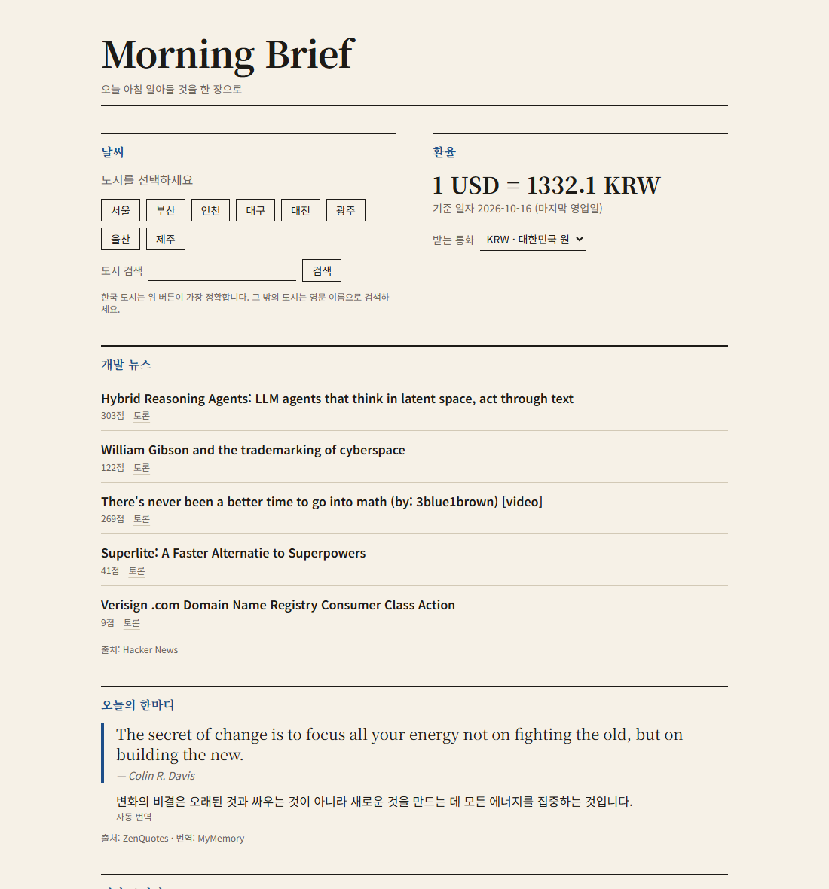
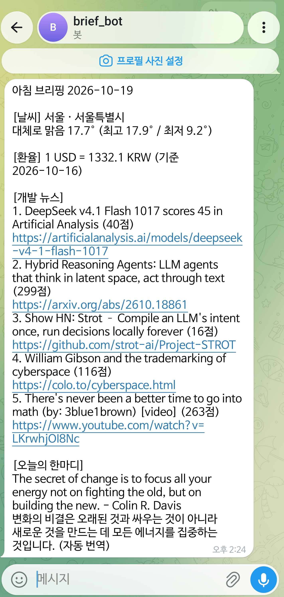
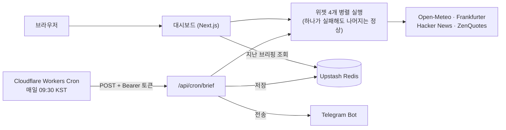

# Morning Brief

날씨, 환율, 개발 뉴스, 오늘의 한마디를 아침마다 한 장으로 모아 웹 대시보드에 보여 주고, 같은 내용을 Telegram으로 보내 주는 개인 브리핑 서비스입니다. 매일 오전 9시 30분(KST)에 Cloudflare Workers Cron이 스스로 깨어나 브리핑을 만들고 저장하며, 지난 브리핑은 날짜별로 다시 열어 볼 수 있습니다.

**데모:** https://morning-brief-six-nu.vercel.app/



같은 내용이 Telegram 메시지로도 도착합니다.



## 왜 만들었나

아침마다 날씨 앱, 환율 사이트, 뉴스 사이트를 따로 여는 일이 번거로웠습니다. 그래서 한 화면에 모으고, 열지 않아도 정해진 시간에 브리핑이 도착하게 만들었습니다. 서버를 직접 운영하지 않고 무료 서비스(Vercel, Upstash, GitHub Actions)만으로 돌아가게 한 것도 목표였습니다.

## 주요 기능

| 기능 | 설명 |
|---|---|
| 날씨 | 도시를 고르면 현재 기온·날씨·오늘 최고/최저를 보여 줍니다. 한국 주요 8개 도시는 좌표를 고정해 정확하게, 그 밖의 도시는 이름 검색으로 고릅니다. 고른 도시는 쿠키에 저장됩니다 |
| 환율 | USD 기준 8개 통화(KRW, JPY, EUR, CNY, GBP, AUD, CAD, CHF)를 한 번에 받아 두고, 통화를 바꾸면 서버 재조회 없이 즉시 전환합니다. 선택은 주소(`?to=`)에 남아 새로고침해도 유지됩니다 |
| 개발 뉴스 | Hacker News 상위 글을 걸러 5건을 보여 줍니다 |
| 오늘의 한마디 | 영어 명언을 한글로 자동 번역해 함께 보여 줍니다. 번역이 실패하면 영어 원문만 보여 줍니다 |
| 자동 브리핑 | 매일 09:30 KST에 브리핑을 만들어 저장하고 Telegram으로 전송합니다 |
| 지난 브리핑 | 저장된 날짜 목록에서 고르면 그날의 브리핑을 읽기 전용으로 다시 봅니다 |

## 동작 구조



- 대시보드(오늘 화면)와 자동 브리핑 API는 같은 위젯 코드를 씁니다. 위젯은 화면도 저장소도 모르고, 데이터를 가져와 정해진 모양으로 돌려주기만 합니다.
- 저장과 Telegram 전송은 서로를 막지 않습니다. 저장이 실패해도 메시지는 가고, 전송이 실패해도 저장은 남습니다. 둘 중 하나라도 실패하면 API가 502로 응답해 호출한 쪽(Worker)이 실패로 기록합니다.

## 기술 스택

| 구분 | 사용 |
|---|---|
| 프레임워크 | Next.js 16 (App Router, `cacheComponents`) |
| 언어 | React, TypeScript (strict) |
| 스타일 | Tailwind CSS 4 |
| 외부 응답 검증 | zod 4 |
| 테스트 | Jest 30, React Testing Library |
| 저장소 | Upstash Redis (REST API를 `fetch`로 직접 호출, SDK 없음) |
| 알림 | Telegram Bot API (`fetch`, SDK 없음) |
| 스케줄 | Cloudflare Workers Cron (GitHub Actions는 수동 실행용) |
| 배포 | Vercel |
| 글꼴 | Noto Serif KR, Noto Sans KR (SIL OFL 1.1) |

런타임 의존성은 `next`, `react`, `react-dom`, `zod` 네 개뿐입니다. 필요해지는 시점에만 설치하는 원칙을 지켰습니다.

## 설계하면서 신경 쓴 부분

### 부분 실패 허용

위젯 하나가 실패해도 화면 전체가 망가지지 않습니다. 모든 위젯은 `{ status: 'ok', data }` 또는 `{ status: 'error', message }`를 돌려주고, `Promise.allSettled`로 모아 실패한 카드만 오류로 표시합니다.

### 외부 데이터 검증

- 모든 외부 호출에 타임아웃을 두고, 응답은 zod로 검증한 뒤에만 사용합니다.
- 뉴스 제목·명언처럼 외부에서 온 문자열은 항상 텍스트로만 그립니다(HTML 해석 없음). 뉴스 링크는 `http(s)`만 허용합니다.
- 쿠키에 저장된 도시, `?date=` 같은 사용자 입력은 매번 다시 검증합니다. 잘못된 값은 화면에 되풀이하지 않습니다.

### 비밀값 관리

- 자동 실행 API는 Bearer 토큰을 상수 시간 비교로 검사하고, 인증이 실패하거나 설정이 빠졌을 때는 외부 API를 전혀 호출하지 않습니다.
- Telegram 토큰은 URL 경로에 들어가므로 형식을 엄격히 검사하고, 실패 사유에 토큰·주소·본문이 섞이지 않게 했습니다. 응답에는 `saved`/`sent`/`failed` 상태만 싣고 자세한 이유는 서버 로그에만 남깁니다.
- 저장소에는 `.env.example`(값 없음)만 올라가 있습니다.

### 예약 실행 테스트

- 매일 실행은 Cloudflare Worker(`worker/`)가 맡습니다. 호출 주소·Bearer 헤더·타임아웃·재시도 없음·실패 전달을 단위 테스트로 확인합니다.
- `.github/workflows/morning-brief.yml`(수동 실행 전용)을 YAML로 해석해 규칙을 검사하는 테스트도 있습니다. 저장소 권한 없음(`permissions: {}`), 외부 액션 미사용, 비밀값은 `env`로만 전달, 스크립트에 `${{ }}` 식 금지, 재시도 없음(중복 전송 방지), 예약(`schedule`) 없음 등을 지키는지 확인합니다.

## 운영하며 겪은 문제와 해결

배포 후 첫 주에 아침 메시지가 제때 오지 않아 원인을 추적하고 고친 기록입니다. 문제를 찾는 데는 GitHub Actions 로그와 `wrangler tail`을 썼고, 고친 코드는 Codex 검토를 거쳤습니다.

| 문제 | 원인 | 해결 |
|---|---|---|
| 09:30 KST 브리핑이 14:08에 도착 | GitHub Actions 예약(cron) 실행이 약 4시간 38분 늦게 시작됨. 로그상 잡이 만들어진 뒤에는 러너가 즉시 배정되고 앱도 2초 만에 응답했음. 이전 cron도 1~3시간씩 밀렸음 | 앱은 그대로 두고 스케줄러만 Cloudflare Workers Cron으로 교체. GitHub 워크플로는 수동 실행 전용으로 줄이고 `schedule`을 제거(두 곳이 부르면 Telegram이 중복 전송됨) |
| 새 스케줄러가 401로 실패 | Cloudflare에 등록된 `CRON_SECRET` 앞에 눈에 안 보이는 BOM(`EF BB BF`)이 붙어 있었음. 실행 로그의 헤더 바이트로 확인했고, PowerShell 5.1 파이프로 등록한 값에서 생긴 것으로 보임(Node로 다시 등록한 값은 정상 동작) | 시크릿을 교체하고, Worker가 공백·BOM·한글이 섞인 `CRON_SECRET`·`BRIEF_URL`을 호출 전에 막도록 검사 추가(값은 오류 메시지에 싣지 않음). 런북에 "파이프로 넣지 말고 프롬프트에 붙여넣기" 명시 |
| 리다이렉트 시 토큰 유출 가능성 (Codex 지적) | Worker의 `fetch`가 기본으로 리다이렉트를 따라가면 Authorization이 다른 주소로 전달될 수 있음 | `redirect: 'manual'`로 막고 3xx는 실패로 처리 |
| 배포 순서에 따른 실행 누락 (Codex 지적) | cron을 켠 뒤 시크릿을 넣으면 그 틈의 실행이 설정 오류로 실패 | 시크릿 등록 → 배포 순서로 런북 수정 |
| 시각을 바꿔 시험했는데 실행되지 않음 | 4~5분 뒤로 잡은 시험은 실행되지 않았고 20분 뒤로 잡은 시험 2회는 정시에 실행됨(`outcome: ok`). Cloudflare 문서상 cron 변경은 반영에 시간이 걸릴 수 있어 그 영향으로 추정 | 시험은 20분 뒤로 잡도록 런북에 기록 |

배운 점: 외부 스케줄러의 시각은 보장이 아니라 "대략"이므로 로그로 실제 실행 시각을 확인해야 합니다. 비밀값은 눈에 안 보이는 문자까지 의심해야 하고, 값 자체를 로그에 남기지 않도록 검사는 호출 전에 합니다.

### 공개 데모와 쓰기 분리

대시보드와 조회 API는 누구나 읽을 수 있지만, 저장·전송을 일으키는 엔드포인트는 토큰이 없으면 열리지 않습니다.

## 개발 방식

- 기능을 작은 단위(U1~U14)로 쪼개 한 번에 하나씩 만들었고, 요구사항 ID(REQ-F-001 등)와 단위를 연결해 `docs/ai/`에 기록했습니다.
- 모든 단위는 TDD(실패하는 테스트 → 최소 구현 → 정리)로 진행했습니다. 현재 테스트 47개 파일, 654건이 통과합니다.
- 코드를 쓴 단위마다 별도의 리뷰 라운드를 거쳐 지적을 반영하거나 반영하지 않은 이유를 남겼습니다. 이 프로젝트는 AI 멀티 에이전트를 구축하여 개발했습니다. Claude로 개발하고, MCP로 연결한 Codex에게 검토를 받았습니다.
- 로컬에서 끝까지 확인하다가 실제 서버에서만 드러난 버그(경로마다 따로 생기던 메모리 저장소, 오류 메시지로 새던 응답 본문 등)도 고쳤습니다.

## 디자인

신문 1면에서 착안한 편집 디자인입니다. 종이색 바탕, 잉크색 글자, 얇은 구분선, 포인트 색 하나만 쓰고 둥근 카드와 그림자는 쓰지 않았습니다. 제목과 큰 숫자는 세리프, 본문은 산세리프이며 숫자는 자릿수가 맞는 `tabular-nums`로 표시합니다. 색은 `globals.css`의 토큰 한 곳에서 관리하고, 시스템 설정에 따라 다크 모드로 바뀝니다. 본문·보조 글자 모두 WCAG AA 대비(4.5:1) 이상입니다. 화면은 2열에서 1열로 접히는 반응형입니다.

## 로컬 실행

```bash
npm install
npm run dev          # http://localhost:3000
npm test             # Jest
npm run build && npm start
```

저장·조회까지 로컬에서 시험하려면 메모리 저장소를 씁니다(서버를 다시 켜면 사라짐).

```bash
SNAPSHOT_STORE=memory CRON_SECRET=<임의의 긴 문자열> npm start
curl -X POST localhost:3000/api/cron/brief -H "Authorization: Bearer <같은 문자열>"
```

Telegram 설정이 없으면 전송은 `failed`(502)가 되고 저장은 됩니다.

## 환경변수

`.env.example`에 설명이 있습니다. 값은 절대 커밋하지 않습니다.

| 이름 | 용도 |
|---|---|
| `CRON_SECRET` | 자동 실행 API 인증용 비밀 문자열 (Cloudflare Worker 시크릿과 GitHub Secrets에도 같은 값) |
| `BRIEF_CITY` | 자동 브리핑의 날씨 도시 (기본 서울) |
| `UPSTASH_REDIS_REST_URL` / `UPSTASH_REDIS_REST_TOKEN` | 브리핑 저장소 |
| `TELEGRAM_BOT_TOKEN` / `TELEGRAM_CHAT_ID` | Telegram 알림 |
| `SNAPSHOT_STORE` | 개발용(`memory`). 배포 환경에서는 비워 둠 |

## API

| 메서드 · 경로 | 설명 | 접근 |
|---|---|---|
| `POST /api/cron/brief` | 브리핑 생성 → 저장 → Telegram 전송. 응답은 `{ date, widgets, snapshot, telegram }` | Bearer 토큰 필요 |
| `GET /api/brief` | 저장된 브리핑 조회 (`?date=YYYY-MM-DD`, 생략하면 오늘(한국 시간)). 없으면 404 | 공개 |
| `GET /api/brief/history` | 저장된 날짜 목록, 최신순 (`?limit=1~90`, 기본 30) | 공개 |

## 배포

Vercel에 저장소를 가져와 환경변수를 등록하고, Cloudflare Worker(`worker/`)에 `BRIEF_URL`(배포 주소)과 `CRON_SECRET`을 시크릿으로 등록해 배포하면 매일 09:30 KST에 자동 실행됩니다. GitHub 저장소 Secrets의 같은 값은 수동 실행(Run workflow)용입니다. 단계별 절차와 점검표는 [배포 런북](docs/ai/13_deploy_runbook/morning-brief-deploy-runbook.md)에 있습니다.

## 폴더 구조

```
src/
├── app/            페이지와 API 라우트
├── widgets/        데이터를 가져오는 쪽 (weather, exchange, news, quote)
├── components/     화면과, 화면에 데이터를 넘기는 쪽
├── brief/          자동 브리핑 로직 (인증, 생성, 저장·전송 연결)
├── storage/        스냅샷 저장소 (Upstash Redis / 개발용 메모리)
└── notify/         Telegram 메시지 만들기·보내기
worker/             매일 09:30 KST에 API를 부르는 Cloudflare Worker (cron 전용)
__tests__/          src와 worker의 테스트
docs/ai/            요구사항, API 계약, 배포 런북 등 설계 문서
```

의존 방향은 `app → components / brief / storage / notify → widgets` 입니다. 자세한 설명은 [디렉터리 문서](docs/ai/03_directory_structure/morning-brief-directory.md)를 봅니다.

## 알려진 한계

- 같은 날 브리핑을 다시 실행하면(수동 실행 포함) 저장본은 덮어쓰이고 Telegram 메시지는 한 번 더 갑니다(의도된 동작이며 재시도는 하지 않습니다).
- 도시 검색은 공개 기능이라 방문자가 많아지면 무료 지오코딩 한도를 쓸 수 있습니다. 요청 제한은 아직 없습니다.
- 한글 번역은 무료 번역 API(MyMemory) 품질에 따라 어색할 수 있습니다.
- 뉴스는 요청마다 Hacker News를 조회합니다(캐시 없음).
- 저장은 두 단계(값 저장 → 날짜 색인)라 원자적이지 않으며, 같은 요청을 다시 보내도 결과가 같게 만들어 두었습니다.
- Cloudflare cron도 시각을 보장하지는 않습니다. 배포 후 며칠은 도착 시각을 확인해야 합니다.

## 데이터 출처와 라이선스

| 데이터 | 출처 |
|---|---|
| 날씨 | [Open-Meteo](https://open-meteo.com/), CC BY 4.0 |
| 환율 | [Frankfurter](https://frankfurter.dev/) (유럽중앙은행 기준) |
| 뉴스 | [Hacker News API](https://github.com/HackerNews/API) |
| 명언 | [ZenQuotes](https://zenquotes.io/) |
| 번역 | [MyMemory](https://mymemory.translated.net/) |
| 글꼴 | [Noto Sans KR](https://fonts.google.com/noto/specimen/Noto+Sans+KR), [Noto Serif KR](https://fonts.google.com/noto/specimen/Noto+Serif+KR), SIL Open Font License 1.1 |

각 서비스의 이용 약관과 한도는 바뀔 수 있습니다. 상업적으로 쓰려면 약관을 다시 확인하세요. 이 저장소 코드의 라이선스는 아직 정하지 않았습니다.
